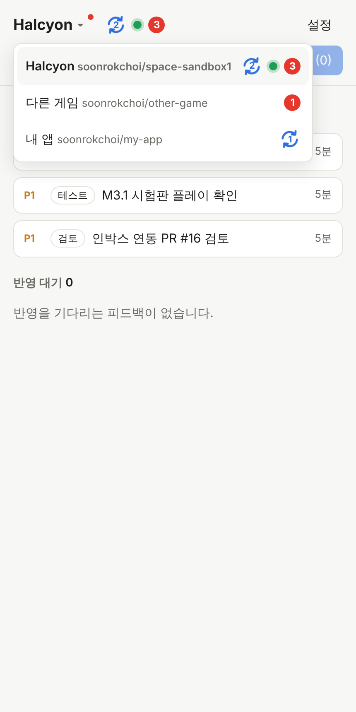

# 할 일 인박스

AI가 개발을 계속 진행하는 동안, 사람이 해야 할 일(검토, 읽기, 테스트, 결정)만 중요도순으로 모아 보여주고 버튼으로 피드백을 받는 정적 웹앱입니다. GitHub Pages에서 돌아가고 서버가 없습니다.



## 동작 방식

- **카드 = 개발 대상 저장소의 GitHub 이슈.** `human:review|read|test|decide` 라벨이 붙은 열린 이슈만 보입니다. `prio:P0|P1|P2`로 정렬합니다(없으면 P2).
- **본문 맨 위의 ```` ```inbox ```` JSON 블록**에서 요약, 이유, 예상 시간, 확인 포인트, 링크, 결정 선택지를 읽습니다. 형식은 [templates/target-repo/CLAUDE.inbox.md](templates/target-repo/CLAUDE.inbox.md)에 있습니다.
- **버튼은 저장만 합니다.** 누르면 이슈에 코멘트(사람이 읽을 문장 + 숨은 JSON)가 달리고 `feedback:pending` 라벨이 붙습니다. AI는 돌지 않습니다.
- **AI 호출은 모아서 합니다.** "지금 반영" 버튼이 개발 대상 저장소에 `repository_dispatch`(`inbox-flush`)를 보내고, 그 저장소의 GitHub Actions가 Claude를 한 번 실행해 쌓인 피드백을 모두 반영합니다. 정기 실행도 같은 워크플로에서 켤 수 있습니다.

## 설정

1. **이 저장소:** Settings → Pages → Source를 "GitHub Actions"로 바꿉니다. main에 푸시하면 테스트 후 배포됩니다.
2. **GitHub 토큰:** fine-grained personal access token을 만들고, 개발 대상 저장소 하나에만 권한을 줍니다.
   - Issues: Read and write (카드 읽기, 코멘트, 라벨)
   - Contents: Read and write ("지금 반영"의 `repository_dispatch`에 필요)
   - 토큰은 브라우저 localStorage에만 저장됩니다. 공용 기기에서는 쓰지 마세요.
3. **개발 대상 저장소(예: space-sandbox1):**
   - [templates/target-repo/.github/workflows/inbox-flush.yml](templates/target-repo/.github/workflows/inbox-flush.yml)을 같은 경로에 복사합니다.
   - 저장소 Secrets에 `CLAUDE_CODE_OAUTH_TOKEN`(또는 `ANTHROPIC_API_KEY`)을 넣습니다. 터미널에서 `claude setup-token`으로 OAuth 토큰을 만들 수 있습니다.
   - [CLAUDE.inbox.md](templates/target-repo/CLAUDE.inbox.md) 내용을 CLAUDE.md(그리고 AGENTS.md)에 붙여 AI가 카드를 만들고 피드백을 읽게 합니다.
4. 배포된 페이지에서 "설정"을 눌러 `owner/repo`와 토큰을 입력합니다.

## 개발

```sh
npm test      # 카드 파싱·정렬·피드백 형식 테스트 (Node 22)
npm start     # 로컬 미리보기
```

빌드 단계는 없습니다. `index.html`, `styles.css`, `src/`가 그대로 배포됩니다.

## 라이선스

[MIT](LICENSE)
